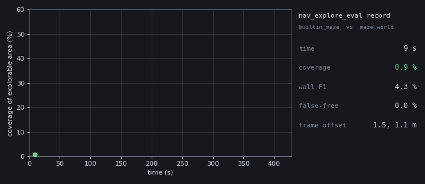

# nav_explore_eval

[](https://github.com/darshmenon/nav_explore_eval/actions/workflows/ci.yml)
[](https://docs.ros.org/)
[](LICENSE)

**How good was that exploration run?** Score any ROS 2 exploration against a ground-truth map: coverage, wall accuracy, and time to 25 / 50 / 75 / 90 %. It only watches `/map` and `/odom`, so it works with any explorer, any SLAM and any robot.



*A real 7-minute run: `explore:=true` on a Gazebo maze, scored against the exact ground truth built from the world file. Data: `docs/demo_run.json`, renderer: `docs/make_demo_gif.py`.*

## Quick start

```bash
# 1. exact ground truth from your Gazebo world (no SLAM run needed); --seed = robot spawn
ros2 run nav_explore_eval nav_explore_eval truth-from-world maze.world --out maze_truth --seed 0 0

# 2. start your explorer as usual, then score it live (writes a JSON report at the end)
ros2 run nav_explore_eval nav_explore_eval record --truth maze_truth.yaml --label my_explorer --out run.json --align

# 3. compare runs side by side, optional chart
ros2 run nav_explore_eval nav_explore_eval compare run.json other.json --png compare.png

# or score a map you already saved
ros2 run nav_explore_eval nav_explore_eval score map.yaml maze_truth.yaml --align
```

Real output of the run above:

```
       label  cov%   f1%  leak%  path_m  t25%(s)  t50%(s)  t75%(s)  t90%(s)
builtin_maze  43.8  64.1    0.0    15.9      158        -        -        -
```

## What it measures

| Metric | Meaning |
|---|---|
| `coverage` | share of the **explorable** free space (reachable from the spawn point) the map has marked free |
| `wall F1` | precision and recall of wall cells within `--tol` metres (default 0.10) |
| `leak` (false-free) | share of real wall cells the map shows as free space, which is the dangerous error |
| `t25 … t90` | interpolated time to reach each coverage level (`-` = never reached) |
| `path_m` | distance driven, from `/odom` |

- **Auto-align** (`--align`): a SLAM map starts at the robot, not at the truth map's origin, so the tool finds the translation between the two frames by FFT correlation of the walls (the run above found a 1.5 m, 0.9 m offset).
- **Ground truth from the world file**: rasterises the box and cylinder collisions that cross the lidar height (`--z`) and counts only space reachable from `--seed` as explorable, so sealed-off rooms and the outside never count against you.

## Limits

- Alignment is translation-only: a SLAM frame rotated against the truth needs `--offset` or a re-saved map.
- `truth-from-world` reads boxes and cylinders; meshes, heightmaps and `<include>` models are not supported yet.
- Two SLAM runs of the same world can score low on wall F1 even when they look alike. Raise `--tol` when comparing runs against each other, and prefer a world-file truth.
- Single run per label: no repeat statistics yet.

## Roadmap

- `--repeat N` trials with mean and spread, and a results leaderboard fed by JSON pull requests
- multi-robot: merged coverage, per-robot contribution, overlap
- rotation in auto-align; mesh and `<include>` models in `truth-from-world`
- offline scoring from a rosbag; HTML report; PyPI release

Build: `colcon build --packages-select nav_explore_eval`. Tests: `python3 -m pytest test` (the live `record` tests run when ROS 2 is sourced). Part of a set with [nav2_doctor](https://github.com/darshmenon/nav2_doctor) and [nav2_fault_inject](https://github.com/darshmenon/nav2_fault_inject).
